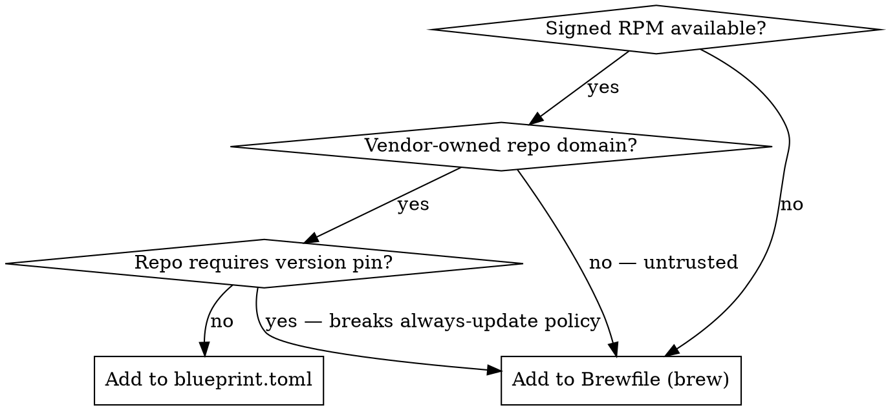

# Add Package to VM

## Decision: RPM or Brew?



**Vendor-owned** = repo domain operated by the software's own publisher (microsoft.com, cloudflare.com, fedoraproject.org). A third-party mirror or JFrog instance does not qualify even with a signed key.

Paths below are under `variants/devbox/`.

## Adding to blueprint.toml (RPM)

1. Append to the `packages` array:
   ```toml
   { name = "pkg-name", version = "*" },
   ```
2. If the package needs a new external repo, add a `[[customizations.repositories]]` stanza. Required fields: `id`, `name`, `baseurls`, `gpgcheck = true`, `gpgkeys`.
3. Run `make bump-patch` (bumps `blueprint.toml` and the firstboot spec together).

## Adding to the Brewfile (Brew)

1. Add a `brew "<formula>"` line to `bastion-vm-firstboot/SOURCES/Brewfile`.
   - Tapped formulae: `brew "<tap>/<repo>/<formula>"` (e.g. `supabase/tap/supabase`)
2. Add the reason it is not an RPM to the comment block at the top of the Brewfile.
3. Run `make bump-patch`; Brewfile changes affect the image.

## Always bump blueprint version

Every change affecting the VM image requires a version bump (`make bump-patch` for routine tool additions); osbuild uses it for traceability.

## Known decisions

| Tool | Where | Why |
|------|-------|-----|
| kubectl (`kubernetes-cli`) | brew | `pkgs.k8s.io` URL requires minor-version pin |
| actionlint, buf, semgrep, uv, watchexec, supabase | brew | No signed RPM repo / bleeding-edge |
| code-insiders, cloudflared | blueprint RPM | Microsoft and Cloudflare own their repo domains |
